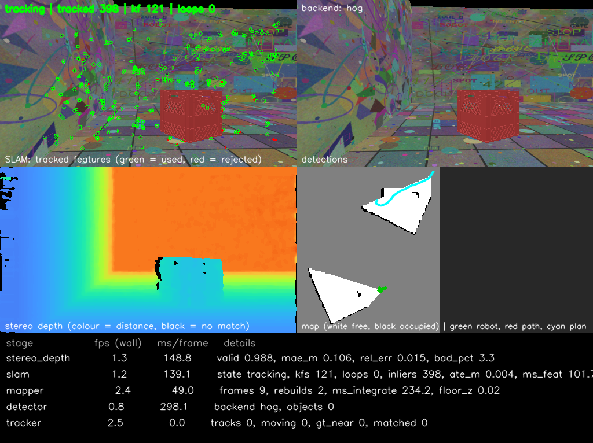
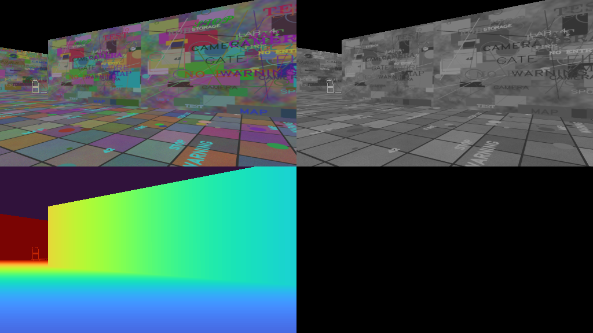
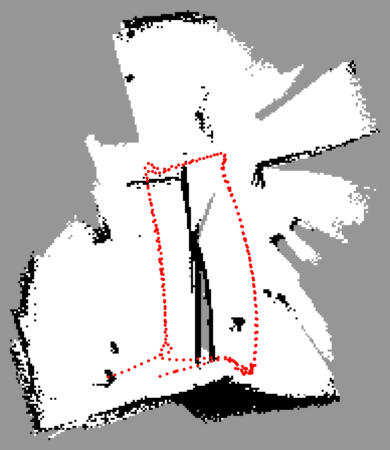
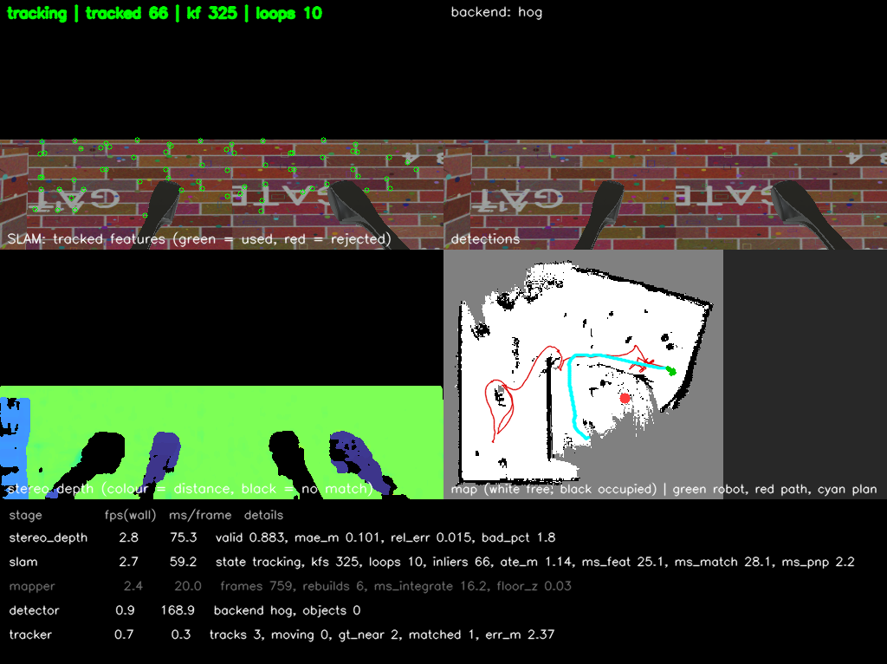

# SpotSense

**Whole-body control and CPU-only stereo SLAM for a simulated Spot quadruped (ROS 2 Jazzy + Webots).**

SpotSense walks a Spot robot in Webots with a convex MPC and a whole-body controller, then lets it
see the world through a stereo camera: it builds a 3D map of everywhere it goes, localises itself in
that map, detects and tracks people and cars (separating moving from static ones), and drives itself
to goals or explores on its own with Nav2. It runs on a laptop CPU, with no GPU and no deep-learning
framework, and every stage is a separate ROS 2 node with a live dashboard, so you can watch how the
pipeline is lined up. It was built to learn how the pieces work, not as a product.

> Not affiliated with Boston Dynamics. "Spot" is their trademark; the robot model comes from the
> Webots distribution.



*The dashboard window: SLAM features (green = used for the pose), detections, stereo depth,
the growing map, and rate / timing / metrics for every stage.*

## What is in it

| Layer | What | Where |
|---|---|---|
| Kinematics | 4-leg inverse kinematics, joint limits | `ik_solver.py`, `spot_4leg_ik.py` |
| State estimation | leg odometry, attitude filter, EKF | `ekf.py`, `estimator_core.py` |
| Control | trot gait, force distribution, convex MPC (own QP solver), whole-body controller | `gait.py`, `mpc.py`, `wbc.py`, `locomotion_core.py` |
| Stereo depth | OpenCV SGBM on a rectified pair, scored against the simulator's hidden range finder | `perception/stereo_depth.py` |
| SLAM | ORB features lifted to 3D, PnP + RANSAC, keyframes, 4-DoF pose graph, gated loop closure | `perception/stereo_slam.py`, `pose_graph.py` |
| Mapping | log-odds voxel map (10 cm), 2D occupancy grid, pseudo laser scan; rebuilt after loop closures | `perception/voxel_map.py`, `mapper.py` |
| Detection + tracking | HOG people detector, YOLOv4-tiny via `cv2.dnn` (optional), Kalman tracker, moving objects masked out of SLAM and map | `perception/detector.py`, `tracker.py` |
| Navigation | Nav2 on the live map, frontier explorer | `config/nav2_spot.yaml`, `perception/explorer_node.py` |
| Simulation | 20 x 20 m textured arena with parked and driving cars, walking pedestrians | `worlds/spot_slam.wbt` |



*Left image, right image, and the simulator's ground-truth depth that the CPU stereo depth is scored against.*

## Requirements

* ROS 2 Jazzy with `webots_ros2`, `nav2_bringup`, `vision_msgs`, `tf2_ros`, OpenCV (python3) and NumPy
* Webots R2025a
* A CPU. No GPU is needed. The simulation runs at roughly 0.2-0.4x real time on a 15 W laptop CPU.

## Build

```bash
mkdir -p ~/ros2_ws/src && cd ~/ros2_ws/src
git clone https://github.com/Hamza47477/Boston_Dynamics_Spot_SLAM_MPC_WBC.git
cd ~/ros2_ws
source /opt/ros/jazzy/setup.bash
colcon build --packages-select spot_controller --symlink-install
source install/setup.bash
```

## Run

```bash
# controller + estimator in the simple world
ros2 launch spot_controller spot_launch.py

# the whole stereo SLAM stack (keep the Webots window open: the cameras need rendering)
ros2 launch spot_controller spot_slam_launch.py

# plus Nav2, and let Spot explore by itself
ros2 launch spot_controller spot_slam_launch.py nav:=true explore:=true

# drive it yourself, or send a goal in map coordinates
ros2 run spot_controller teleop
ros2 run spot_controller goto 3.0 -2.0
```

Useful launch arguments: `controller:=vmc|mpc|mpc_wbc`, `detector:=auto|hog|yolo|oracle`, `rviz:=true`,
`viewer:=false`, `port:=1240`. For cars to be detected, download the YOLOv4-tiny model with
`bash tools/get_yolo_model.sh` (about 23 MB) and use `detector:=yolo`.

## Results (simulation only)

| Test | Result |
|---|---|
| Stereo depth vs ground truth | 98.8 % valid pixels, mean error 6.7-8.4 cm |
| Visual odometry, straight 13.5 m walk | 3.4 cm error (leg-odometry EKF alone: 25 cm) |
| One 31 m lap, whole stack live | SLAM error under 1 cm at the end |
| 14 min autonomous exploration (Nav2 + explorer) | about 317 of 400 m² mapped, 10 of 10 goals reached, 7 loop closures, SLAM error 3 cm |
| Unit tests | 62 functional tests pass |



*Occupancy map rebuilt offline from a recorded walk (white = free, black = occupied, grey = unknown, red = SLAM path).*



*A snapshot from a different exploration run: Nav2 plan in cyan, SLAM path in red, 10 loop closures. The live error
shown in this overlay (1.14 m) is worse than the 3 cm of the 14-minute run in the table.*

## Honest limits

* **Simulation only.** The camera images are noise-free and the wall textures were generated so they are easy to track.
  A real camera and a real room will do worse.
* **Weak object detection.** The default HOG detector finds only people (about 47 % recall, 88 % precision) and no
  cars. The YOLOv4-tiny path exists but has not been tested.
* **Dynamic masking** was only shown to help with ground-truth boxes (error 2.7 m down to 0.26 m); with the real
  detector the benefit is not measured. Moving-object velocity was not scored.
* Tracked object positions are rough (0.1-0.7 m error). The map was only checked by eye.
* The loop-closure gates were tuned on one world. The explorer is greedy and sometimes dithers.
* The stock ament lint tests (`flake8`, `pep257`, `copyright`) fail on this package. Run the real tests with
  `python3 -m pytest test -k 'not flake8 and not pep257 and not copyright'`.

## Documentation

* [`docs/STEREO_SLAM.md`](docs/STEREO_SLAM.md): architecture, each stage, tools, results and the problems found along the way
* [`docs/LOCOMOTION_CONTROL.md`](docs/LOCOMOTION_CONTROL.md) and [`docs/MPC_WBC_Report.pdf`](docs/MPC_WBC_Report.pdf): MPC and whole-body control
* [`docs/STATE_ESTIMATION.md`](docs/STATE_ESTIMATION.md): leg odometry and the EKF
* [`docs/PROJECT_GUIDE.md`](docs/PROJECT_GUIDE.md): commands, topics and how the nodes connect

## License

MIT, see [`LICENSE`](LICENSE).
