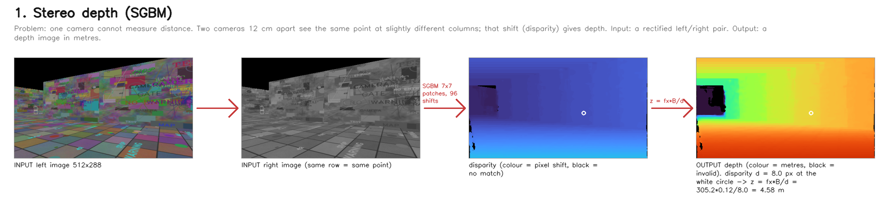
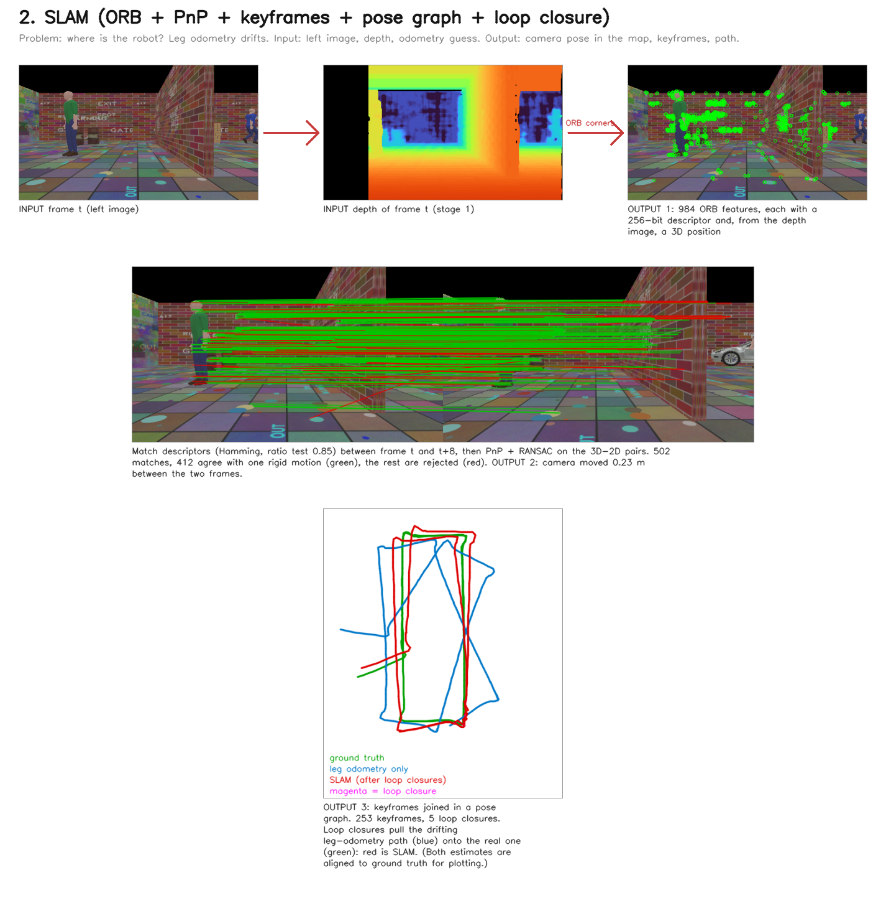
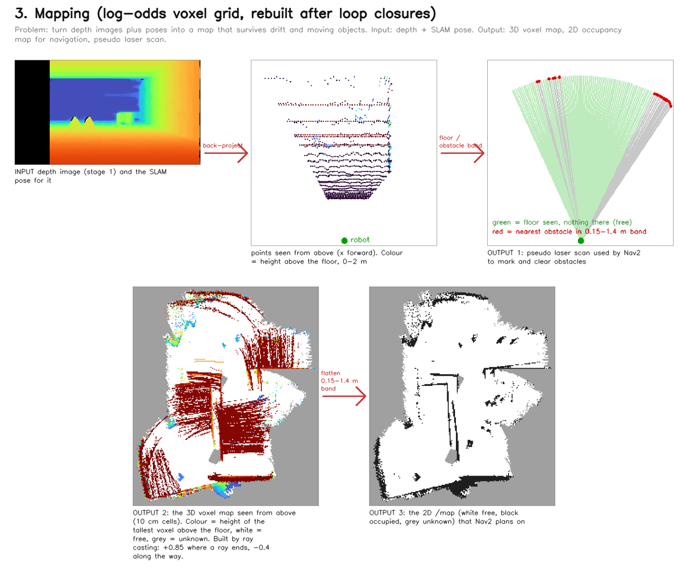
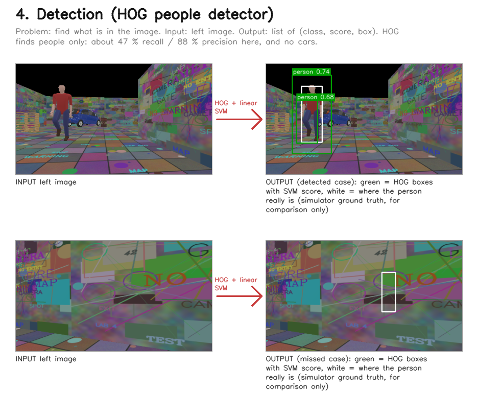
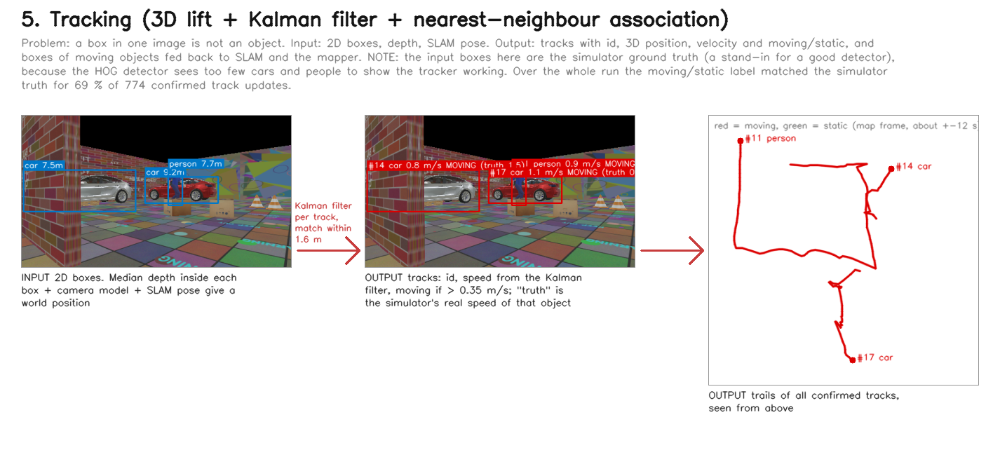
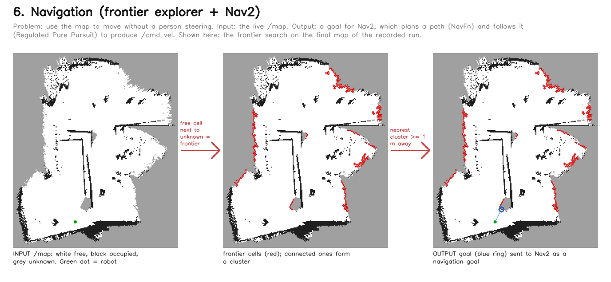

# Perception algorithms: what each one does, what goes in, what comes out

This is the reading guide for `spot_controller/perception/`. For every stage: the problem it solves, the algorithm,
the input, the output, and why the next stage needs it. Numbers are the ones used in the code.

Every figure below is produced by running the real algorithm classes on real recorded frames, not drawn by hand:
`python3 tools/make_pipeline_figures.py --data <recorded run> --samples docs/images/samples --out docs/images/pipeline`.
The recorded run is from the simulator, so these are simulation images.

## The whole pipeline in one picture

```
 left image ─┐                                                        ┌──> viewer (dashboard)
 right image ┴─> [1 STEREO DEPTH] ──depth image──┬──────────────────────┤
                                                 │                      │
 leg-odometry EKF (/odom_estimated) ─────────────┼─> [2 SLAM] ──pose──┬─┴─> [3 MAPPER] ──> /map, /map_3d, /mapper/scan ──> [6 NAV2 + EXPLORER] ──> /cmd_vel
 left image ─────────────────────────────────────┘        ^           │
                                                          │ boxes of  │
 left image + depth ─> [4 DETECTOR] ─2D boxes─> [5 TRACKER]┴─ moving ───┘
                                                  └─> /tracks (3D objects, speed, moving / static)
```

Two loops close the system. **SLAM gives pose to the mapper and the tracker**, and **the tracker gives
"these pixels are a moving object" back to SLAM and the mapper**, so a walking person does not get mistaken for
a wall that moved.

| # | Stage | Node | Input | Output |
|---|---|---|---|---|
| 1 | Stereo depth | `stereo_depth` | left + right image | `/stereo/depth/image_raw` (metres per pixel) |
| 2 | SLAM | `stereo_slam` | left image, depth, `/odom_estimated`, dynamic boxes | `/slam/odom`, TF `map->odom`, keyframes, path |
| 3 | Mapping | `mapper` | depth, SLAM pose and keyframes, dynamic boxes | `/map` (2D), `/map_3d`, `/mapper/scan` |
| 4 | Detection | `detector` | left image (+ depth) | `/detections` (2D boxes + class) |
| 5 | Tracking | `tracker` | 2D boxes, depth, SLAM pose | `/tracks` (3D, speed, moving/static), `/perception/dynamic_boxes` |
| 6 | Navigation | Nav2 + `explorer` | `/map`, `/mapper/scan`, TF | `/cmd_vel` |

---

## 1. Stereo depth (`stereo_depth.py`)



*Stage 1: input pair, disparity and depth (the sample pair in docs/images/samples).*

**Problem.** One camera cannot tell how far something is. Two cameras 12 cm apart can: the same point appears at a
slightly different column in each image.

**Algorithm.** Semi-Global Block Matching (SGBM, OpenCV):
1. For every pixel in the left image, compare a 7x7 patch against patches in the right image along the same row
   (the pair is rectified, so matches only shift horizontally), over 96 possible shifts.
2. Add a smoothness penalty (`P1`, `P2`) that is accumulated along several directions through the image, so
   neighbouring pixels prefer similar shifts. This is the "semi-global" part and it removes most noise.
3. Reject unreliable pixels: left-right consistency check, uniqueness ratio, speckle filter.
4. Convert the shift (disparity `d`, in pixels) to depth: **z = fx · B / d**.

Worked example: fx = 305.17 px, B = 0.12 m, so fx·B = 36.6. A pixel that shifts by `d = 7.3` px is at
z = 36.6 / 7.3 = **5.0 m**. A shift of 1 px more or less changes z a lot when far away (z = 36.6 at d = 1, 18.3 at d = 2),
which is why stereo error grows with distance.

**Input.** Two 512x288 images. **Output.** A 512x288 float image of metres, 0 = no match. 98.8 % of pixels are valid,
mean error 6.7-8.4 cm against the simulator's hidden range finder. The left strip of the image has no partner in the
right image, so both images are padded on the left before matching.

**Why the next stage needs it.** SLAM lifts 2D features to 3D with it, the mapper turns it into a point cloud, and
the tracker reads the distance of a detected person or car from it.

## 2. SLAM (`stereo_slam.py`, `pose_graph.py`, `rigid.py`)



*Stage 2: features and matches on two real frames, and the path after loop closures (replay of a recorded 231 s walk, 253 keyframes, 5 loop closures).*

**Problem.** Where is the robot, and in which frame is the map? The legs give odometry, but it drifts (25 cm over a
13.5 m walk). The camera can correct it by recognising what it has already seen.

**Algorithm, step by step** (one call of `StereoSlam.process` per frame):

1. **Features.** ORB finds up to 1000 corner points in the left image and describes each with a 256-bit binary
   descriptor. Features inside dynamic boxes are dropped.
2. **Lift to 3D.** Each feature's depth (from stage 1) and the camera model give a 3D point in the camera frame.
3. **Predict.** The EKF's motion since the last frame gives a first guess of the new pose. The guess is used to
   *project* the known map points into the image and only look for matches within ~22 px of where they should be.
4. **Match.** Brute-force Hamming distance between descriptors, a ratio test (0.85) against ambiguous matches.
   The map side is the landmarks of the last 8 keyframes (the *local map*).
5. **Pose from 3D-2D matches.** PnP inside RANSAC: pick random small sets of matches, compute a pose, count how
   many other matches agree (reprojection error < 3 px). The pose with most agreeing matches wins, then
   Levenberg-Marquardt refines it using all inliers. Fewer than 15 inliers means tracking is bad.
6. **Gravity alignment.** Roll, pitch and height come from the EKF (it has an IMU and knows gravity); vision only
   supplies x, y and yaw. Without this the camera tilt drifted by degrees and the map filled with fake obstacles.
7. **Keyframes.** A new keyframe is made when the robot has moved 0.35 m, turned 0.3 rad, 2.5 s has passed, or
   fewer than 60 % of the reference keyframe's features are still tracked. A keyframe stores its pose, its
   features and their 3D points.
8. **Pose graph.** Each consecutive keyframe pair becomes an edge: "keyframe j is at this relative pose from i".
   Chain edges drift. The graph is 4-DoF (x, y, z, yaw) because roll/pitch are known from gravity.
9. **Loop closure.** When the robot is back near a place it has been (within 2 m + 3 % of path length, and 8 m of
   path since), the current keyframe is matched against old keyframes. A match needs >= 30 RANSAC inliers. It is
   accepted only if the implied correction is plausible (<= 0.5 m + 3 % of path), because repeated wall textures
   otherwise give false loops.
10. **Optimise.** Gauss-Newton / Levenberg-Marquardt on all keyframe poses at once minimises the sum of squared
    edge errors (`e_t`, `e_psi` in `pose_graph.py`). Loop edges use a Huber loss so one bad loop cannot wreck everything.
    Keyframe 0 is fixed.
11. **When lost.** Fall back to frame-to-frame tracking, then to a weak-edge re-initialisation keyframe, and try
    relocalisation against old keyframes.

**Input.** Left gray image, depth, EKF pose, dynamic boxes. **Output.** `/slam/odom` (the pose in the map frame; the
`covariance[0]` field carries the inlier count and `[1]` the state), TF `map->odom`, `/slam/keyframes`, `/slam/path`,
`/slam/landmarks`.

**Result.** 3.4 cm error over a straight 13.5 m walk (EKF alone: 25 cm). Under 1 cm on a 31 m lap in simulation.

## 3. Mapping (`voxel_map.py`, `mapper.py`)



*Stage 3: one depth frame becomes points and a scan; all frames together become the voxel map and the 2D map.*

**Problem.** Turn "I saw these depth points from this pose" into a map that says where the free space and the
obstacles are, and that survives pose corrections and moving objects.

**Algorithm.**
1. **Back-project** a strided subset of depth pixels to 3D points in the camera frame, drop anything beyond 8 m.
2. **Voxel grid.** A dense 3D grid with 10 cm cells, 40 x 40 m, -0.6 to 3.6 m in height. Each cell stores a
   *log-odds* number (positive = probably occupied).
3. **Ray casting.** For every point, the cell it hits gets +0.85, and every cell the ray crosses on the way from the
   camera gets -0.4. Values are clamped to [-2, 2.4]. Because of the clamp, a cell that was occupied by a person who
   walked away is cleared again after about 4 frames of rays passing through it.
4. **Keep the frames.** Every integrated frame is stored with its reference keyframe. When loop closure moves the
   keyframes by more than 3 cm, the whole map is cleared and **rebuilt** from the stored frames at the new poses, so
   a wall seen twice lands in one place instead of two.
5. **Mask moving objects.** Depth pixels inside a dynamic box are skipped.
6. **Flatten to 2D.** Take the height band 0.15-1.4 m above the floor; any occupied cell marks the column occupied
   (`/map`: 0 free, 100 occupied, -1 unknown).
7. **Pseudo laser scan.** Rays over the horizontal field of view report the nearest obstacle (or +inf for seen free
   floor, NaN for unknown). Nav2 uses this to mark and clear obstacles.

**Input.** Depth image, SLAM pose, keyframes. **Output.** `/map`, `/map_3d` (point cloud), `/mapper/scan`.

## 4. Detection (`detector.py`)



*Stage 4: HOG on real frames, one detection and one miss.*

**Problem.** Find *what* is in the image: people and cars.

**Backends** (chosen with `detector:=`):
* **hog**: OpenCV's HOG + linear SVM pedestrian detector. Histograms of oriented gradients in sliding windows,
  classified by a linear SVM. People only. Measured 47 % recall / 88 % precision, about 79 ms. This is what ran.
* **yolo**: YOLOv4-tiny through `cv2.dnn`: a small convolutional network that predicts boxes and classes in one
  pass (people, cars, trucks, ...). The model file is not in the repo (`tools/get_yolo_model.sh`); this path was
  written but not tested.
* **oracle**: the simulator's ground truth projected into the image. It is a cheat for developing the later stages
  and is never selected automatically.

**Input.** Left image. **Output.** `/detections`: a list of (class, score, box `u0 v0 u1 v1`). Runs on every 3rd frame.

## 5. Tracking (`tracker.py`, `tracker_node.py`)



*Stage 5: boxes in, tracks out. The input boxes are simulator ground truth; "truth" in the labels is the real speed of the object.*

**Problem.** A box in one image is not an object. We want a persistent object with a position in the world and a
speed, and to know whether it moves.

**Algorithm.**
1. **Lift to 3D.** For each box, take the median depth inside it (robust to background pixels) and the camera
   model to get a camera-frame point, then the SLAM pose to get a world position.
2. **Association.** Greedy nearest-neighbour: match each detection to the closest existing track within 1.6 m.
   Unmatched detections start new tracks.
3. **Kalman filter** (one per track). State [x, y, vx, vy], constant-velocity model. *Predict*: position moves by
   velocity x dt, uncertainty grows. *Update*: blend in the new measurement according to their uncertainties. This
   smooths noisy detections and gives a speed estimate for free.
4. **Confirm and classify.** A track becomes real after 3 hits. It is `moving` if its speed exceeds 0.35 m/s; people
   are always treated as dynamic. Static tracks (a parked car, a standing person) are kept for 120 s, so they form
   a small semantic map.
5. **Feedback.** Boxes of dynamic tracks (also projected for frames where the detector missed them) are published on
   `/perception/dynamic_boxes`; SLAM and the mapper ignore those pixels.

**Input.** `/detections`, depth, SLAM pose. **Output.** `/tracks` (3D box, class, id, velocity), markers, dynamic boxes.

## 6. Navigation (Nav2 + `explorer_node.py`)



*Stage 6: the frontier search on the final map of the recorded run.*

**Problem.** Use the map to move without a person steering.

* **Planner (NavFn):** Dijkstra/A* over the costmap built from `/map` plus the live scan.
* **Controller (Regulated Pure Pursuit, 0.3 m/s):** follows the path by steering towards a look-ahead point,
  slowing near obstacles and in curves. A velocity smoother outputs `/cmd_vel`.
* **Explorer:** a *frontier* is a free cell next to unknown space. Connected-component labelling groups frontier
  cells into clusters; the explorer picks the nearest reachable one at least 1 m away and sends it to Nav2 as a goal.
  When it is reached the map has grown, and it picks the next one, until none is left.

---

## Supporting pieces

* `geometry.py`: rigid-body transforms (4x4 matrices), camera intrinsics, the fixed transform between the body frame
  (x forward, y left, z up) and the camera frame (x right, y down, z forward), and a pose history buffer for
  matching image timestamps with poses.
* `rigid.py`: Kabsch (best rotation + translation between two 3D point sets by SVD) with RANSAC around it; used for
  loop closure refinement and for scoring the tracker against ground truth.
* `stats.py` and `viewer_node.py`: every stage reports its rate, time per frame and key metrics; the dashboard shows
  them live.

## Reading order for the code

`stereo_depth.py` (short, one idea) -> `geometry.py` -> `stereo_slam.py` (`process`) -> `pose_graph.py` ->
`voxel_map.py` -> `mapper.py` -> `detector.py` -> `tracker.py` -> `explorer_node.py`.
To run any of it on recorded data without the simulator, use `tools/replay_slam.py`.

## Honest note on the tracker figure

Over the recorded run the tracker's moving/static label agreed with the simulator's true motion for about 69 % of
confirmed track updates. Parked cars were sometimes labelled "moving" at 0.8-1.1 m/s: depth noise and small SLAM
pose jitter look like motion. That is why a track needs several fast frames before it counts as moving, and why
this stage still needs work.
